# Informe Tecnico - AutoPeru Taller: Microservicios con Monitoreo en Kubernetes

**Alumno:** Axel Victor Huapaya Huari
**Curso:** Kubernetes con Prometheus & Grafana - Valle Grande
**Dominio:** proyecto AutoPeru Taller (taller mecanico). Servicio A = inventario de repuestos, Servicio B = ordenes.
**Repositorio:** https://github.com/Axel-Huapaya/ASE251-Microservicios-AutoPeru-Taller

---

## Parte A - Conceptos

### 1. Que es Micrometer y por que se usa en lugar de la libreria directa de Prometheus

Micrometer es una fachada de metricas para aplicaciones JVM, parecida a lo que SLF4J es para el logging. Mi codigo registra metricas con una API unica (`Counter`, `Gauge`, `Timer`, `MeterRegistry`) y la dependencia `micrometer-registry-prometheus` las traduce al formato de texto que Prometheus sabe leer.

Se usa en vez de la libreria cliente de Prometheus porque Spring Boot Actuator ya la integra: con solo agregar la dependencia obtengo gratis metricas de JVM, CPU, hilos y `http_server_requests_seconds`, y mi codigo no queda atado a un proveedor. Si manana el equipo cambia a Datadog u OpenTelemetry, cambio la dependencia del registry y no reescribo ni una linea de `RepuestosService` ni `OrdenesService`.

Ejemplo de mi codigo (`RepuestosService`):
```java
Counter.builder("repuestos.consultas").register(registry);
```
Micrometer lo expone como `repuestos_consultas_total`, que es la convencion de nombres de Prometheus.

### 2. Diferencia entre Counter, Gauge y Timer

- **Counter**: valor que solo sube (o se reinicia a 0 al reiniciar el proceso). Sirve para contar eventos; lo util es su tasa con `rate()`/`increase()`.
  _Mi ejemplo:_ `ordenes_creadas_total` en `OrdenesService`, que se incrementa cada vez que se confirma una orden.
- **Gauge**: valor instantaneo que puede subir y bajar; es una "foto" del estado actual.
  _Mi ejemplo:_ `repuestos_agotados`, calculado en cada scrape contando los repuestos con stock 0, y `repuestos_delay_artificial_ms`, que refleja el retardo configurado.
- **Timer**: mide cuanto dura una operacion y cuantas veces ocurrio. Exporta `_count`, `_sum`, `_max` y, con `publishPercentileHistogram()`, buckets para calcular percentiles.
  _Mi ejemplo:_ `ordenes_repuestos_llamada_seconds`, que mide cada llamada HTTP de ordenes hacia el servicio de repuestos; con ella se ve la latencia que el servicio de repuestos le impone a ordenes.

### 3. Que es un ServiceMonitor y como sabe el Prometheus Operator que monitorear

Un `ServiceMonitor` es un recurso personalizado (CRD) del Prometheus Operator que declara **que Services** hay que raspar, en **que puerto**, **que ruta** y cada **cuanto**. Evita editar a mano `prometheus.yml`.

El Operator vigila permanentemente el API de Kubernetes. Prometheus (que el Operator crea a partir de un recurso `Prometheus`) tiene dos selectores: `serviceMonitorSelector` (por labels del ServiceMonitor) y `serviceMonitorNamespaceSelector` (por namespace). El Operator toma los ServiceMonitors que cumplan ambos, y para cada uno busca los Services cuyos labels coincidan con `spec.selector.matchLabels`, resuelve los endpoints de esos Services y genera la configuracion de scrape.

En mi proyecto, `k8s/monitoring/servicemonitors.yaml` selecciona `app: repuestos-service` y `app: ordenes-service`, que son los labels de mis dos Services, y apunta al puerto llamado `http` con `path: /metrics`.

### 4. Diferencia entre liveness probe y readiness probe

- **Liveness**: responde "el proceso sigue sano?". Si falla `failureThreshold` veces seguidas, el kubelet **mata y reinicia el contenedor**. Sirve para recuperarse de bloqueos.
- **Readiness**: responde "puede recibir trafico ya?". Si falla, el pod **no se reinicia**: solo se quita de los endpoints del Service y deja de recibir peticiones hasta que vuelva a pasar. Sirve durante el arranque o ante una sobrecarga temporal.

En mis Deployments ambos apuntan a `/health`, un endpoint propio que no depende del otro servicio. Es importante: si el health de ordenes consultara al servicio de repuestos, una caida del servicio de repuestos haria fallar tambien a ordenes y Kubernetes lo reiniciaria sin necesidad.

Ademas agregue un **startup probe** sobre el mismo endpoint: mientras no pase, kubelet no ejecuta el liveness. Lo necesite porque la JVM tarda cerca de 80 segundos en arrancar en Minikube y el liveness estaba matando el contenedor antes de que terminara de iniciar (ver la seccion de observaciones al final).

### 5. Por que es necesario apuntar Docker al daemon de Minikube antes de construir

Minikube corre su propio nodo con su propio daemon de Docker, aislado del Docker de mi maquina. Si construyo con el Docker del host, la imagen existe solo ahi y el nodo de Minikube no la ve. Como mis Deployments usan `imagePullPolicy: Never` (no hay registry), el pod quedaria en `ErrImageNeverPull`.

`eval "$(minikube docker-env)"` redirige mi cliente `docker` hacia el daemon de Minikube, asi `docker build` deja la imagen justo donde Kubernetes la va a buscar.

### 6. Que ocurre si no configuro el selector de ServiceMonitors en el values.yaml

Por defecto el chart `kube-prometheus-stack` configura Prometheus para descubrir **solo** los ServiceMonitors que tengan el label `release: <nombre del release>` (y, segun la version, solo en su propio namespace). Mis ServiceMonitors viven en el namespace `autoperu-taller`, asi que Prometheus los **ignoraria en silencio**: el objeto se crea sin error en Kubernetes, pero en `/targets` no aparece ningun target de mis servicios y los paneles de Grafana quedan en "No data".

Por eso mi `values.yaml` define `serviceMonitorSelectorNilUsesHelmValues: false`, `serviceMonitorSelector: {}` y `serviceMonitorNamespaceSelector: {}`, lo que hace que Prometheus seleccione todos los ServiceMonitors de todos los namespaces. Lo mismo aplica a las reglas (`ruleSelector...`) para que el `PrometheusRule` sea cargado.

---

## Parte B - PromQL

**1. Tasa de requests por minuto de ordenes-service en los ultimos 5 minutos**
```promql
sum(rate(http_server_requests_seconds_count{namespace="autoperu-taller", application="ordenes-service", uri=~"/api.*"}[5m])) * 60
```

**2. Latencia p95 del endpoint mas critico (crear orden)**
```promql
histogram_quantile(0.95,
  sum by (le) (rate(http_server_requests_seconds_bucket{namespace="autoperu-taller", application="ordenes-service", uri="/api/ordenes", method="POST"}[5m]))
)
```

**3. Estado UP/DOWN de ambos servicios al mismo tiempo**
```promql
up{namespace="autoperu-taller", job=~"repuestos-service|ordenes-service"}
```
(1 = UP, 0 = DOWN; una serie por servicio.)

**4. Pregunta de negocio: que porcentaje de intentos de compra se perdio por falta de stock en los ultimos 10 minutos**
```promql
sum(increase(ordenes_rechazadas_stock_total{namespace="autoperu-taller"}[10m]))
/
(sum(increase(ordenes_creadas_total{namespace="autoperu-taller"}[10m])) + sum(increase(ordenes_rechazadas_stock_total{namespace="autoperu-taller"}[10m])))
```

---

## Parte C - Casuisticas

### Casuistica 1 - El Servicio Caido (CrashLoopBackOff)

**Contexto narrativo.** Es temporada alta de mantenimiento antes de las vacaciones y el taller esta lleno de clientes. Un integrante del equipo "endurece" la configuracion de los probes del servicio de repuestos para detectar fallos mas rapido, pero se equivoca en la ruta del liveness probe (`/health-roto`) y despliega el cambio un viernes por la tarde. El contenedor arranca bien, pero el kubelet lo declara muerto una y otra vez y lo reinicia hasta entrar en CrashLoopBackOff.

**Sintoma.** Quien intenta hacer una orden recibe `503 - El servicio de repuestos no respondio a tiempo o no esta disponible` de forma intermitente y luego constante. Ordenes esta vivo, pero sin el servicio de repuestos no puede confirmar nada.

**Activacion.**
```bash
./scripts/casuisticas/c1-activar.sh
kubectl -n autoperu-taller get pods -w
./load-testing/stress.sh -m ordenes -n 300 -c 3 -s 200
```

**Diagnostico.**
- Grafana: el panel _Reinicios de contenedores_ sube en escalera para `repuestos-service` y el panel _Estado de los servicios_ deja de mostrar UP para ese servicio mientras el pod no esta listo.
- Prometheus `/alerts`: `PodsReiniciandoseSeguido` pasa a **FIRING** y `RepuestosServiceCaido` queda en PENDING (necesita 1 minuto sin instancias listas para disparar).
- `kubectl -n autoperu-taller get pods -w`: el pod de repuestos reinicia una y otra vez; el pod roto llego a **7 reinicios** antes de ser reemplazado al resolver.
- La prueba de carga deja respuestas `503` en ordenes y solo 3 de 100 ordenes confirmadas: sin el servicio de repuestos no hay ordenes.

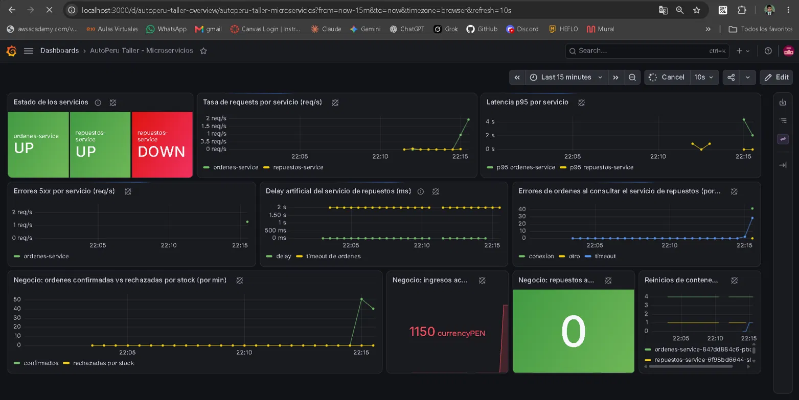

**Evidencia en Prometheus (durante la falla):** la alerta `PodsReiniciandoseSeguido` en FIRING y `RepuestosServiceCaido` en PENDING.

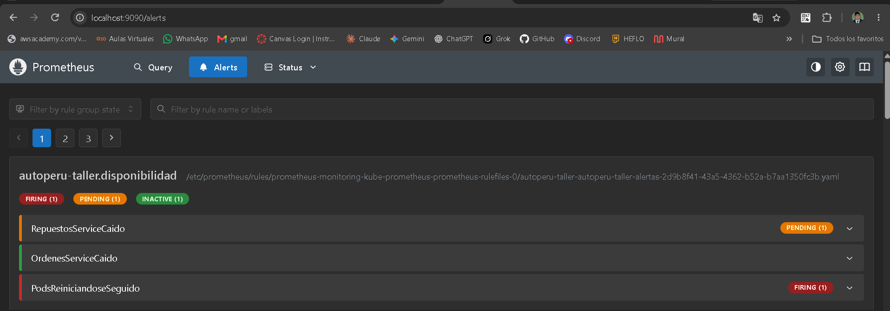

**Resolucion.**
```bash
./scripts/casuisticas/c1-resolver.sh      # kubectl apply -f k8s/repuestos/deployment.yaml
```

**Evidencia de la recuperacion.** El rollout termina bien, el pod nuevo queda en `1/1 Running` con 0 reinicios y el pod roto aparece en `Terminating` con 7 reinicios:

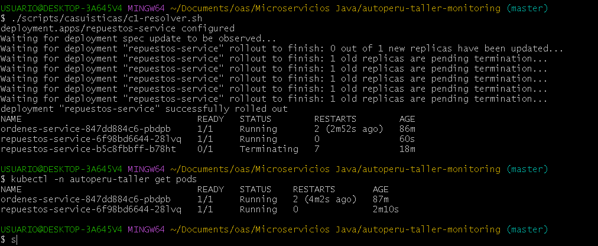

Pasados unos minutos las alertas del grupo `autoperu-taller.disponibilidad` vuelven a INACTIVE:

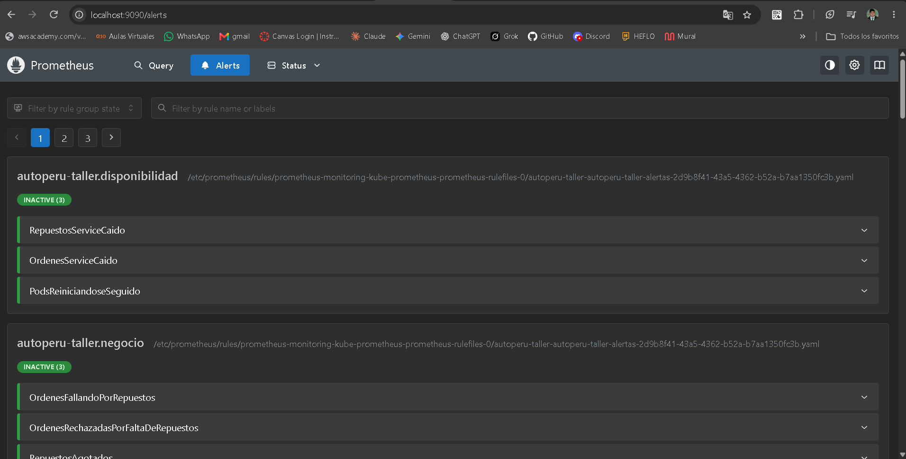

**Leccion tecnica.** Los probes no son decorativos: son el contrato entre la aplicacion y Kubernetes. El **liveness** decide cuando reiniciar un contenedor; un liveness mal configurado convierte una app sana en un bucle de reinicios. El **readiness** decide cuando enviar trafico, sin reiniciar nada. Tambien muestra que `up` por si solo no basta: cuando el pod sale del Service la serie desaparece, por eso la alerta usa `absent(up{...} == 1)`.

---

### Casuistica 2 - El Servicio Lento (timeouts en cascada)

**Contexto narrativo.** El servicio de repuestos recibe una carga de consultas masivas de una empresa de transporte con flota grande y su respuesta se degrada. Ordenes espera como maximo 2 segundos (`REPUESTOS_TIMEOUT_MS=2000`).

**Sintoma.** Los clientes ven que confirmar una orden tarda 2 segundos y termina en `503`. Ordenes parece "roto" aunque su codigo esta intacto.

**Activacion.**
```bash
./scripts/casuisticas/c2-activar.sh 5000     # equivale a: kubectl -n autoperu-taller set env deployment/repuestos-service REPUESTOS_DELAY_MS=5000
./load-testing/stress.sh -m ordenes -n 200 -c 4
```

**Diagnostico.**
- Prueba de carga con el delay activo: las 100 ordenes enviadas terminan en `503` (ver captura de la terminal).
- Panel _Delay artificial del servicio de repuestos_ muestra 5000 ms por encima de la linea del timeout (2000 ms).
- _Latencia p95_ del servicio de repuestos sube a ~5 s y la de ordenes se queda cerca de 2 s (se corta en el timeout).
- _Errores de ordenes al consultar el servicio de repuestos_ sube con `tipo="timeout"`.
- Alertas `RepuestosLatenciaAlta` y `OrdenesFallandoPorRepuestos` en FIRING.
- Comparando ambas latencias se concluye que el culpable es el servicio de repuestos (aguas abajo), no ordenes.

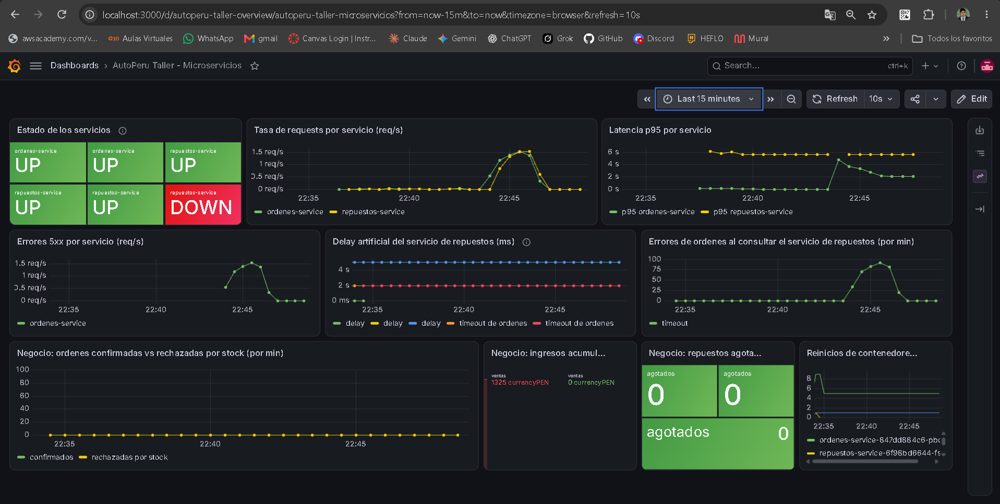

**Evidencia en la terminal.** Con el delay de 5000 ms activo, las 100 ordenes de la prueba de carga terminan en `503` porque ordenes corta a los 2 s:

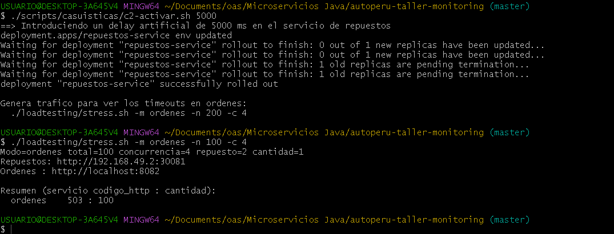

**Evidencia en Prometheus (durante la falla):** `RepuestosLatenciaAlta` (rendimiento) y `OrdenesFallandoPorRepuestos` (negocio) en FIRING.

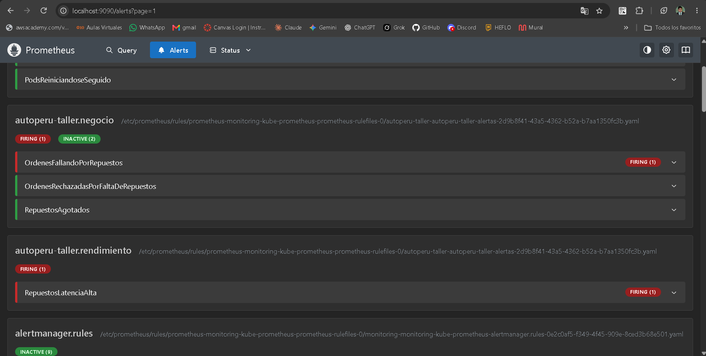

**Resolucion.**
```bash
./scripts/casuisticas/c2-resolver.sh      # REPUESTOS_DELAY_MS=0
```

**Evidencia de la recuperacion.** Las mismas alertas vuelven a INACTIVE una vez que el p95 baja de 1 s:

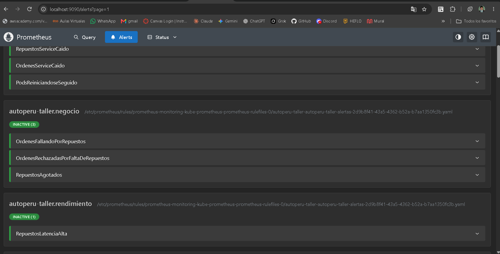

**Leccion tecnica.** La latencia se propaga entre microservicios: el usuario sufre en el servicio B por un problema del A. Sin metricas por servicio (latencia, errores y el gauge del delay) es imposible aislar al culpable; con ellas se ve en segundos. Tambien justifica configurar siempre un timeout: sin el, ordenes se quedaria colgado y agotaria sus hilos.

---

### Casuistica 3 - Repuesto estrella agotado en plena temporada alta (negocio)

**Contexto narrativo.** Una empresa de transporte lleva varias de sus unidades al taller y pide cambio de pastillas de freno en lotes de 5 unidades. Con 30 en stock, se agotan tras 6 ordenes, pero los clientes siguen llegando a pedir servicio de frenos durante horas porque nadie se entero. Infraestructura esta perfecta (todo UP, latencias normales), pero se pierde venta real.

**Sintoma.** El cliente recibe `409 - No hay stock suficiente de Pastillas de freno (disponible: 0 unidades)`.

**Activacion.**
```bash
./scripts/casuisticas/c3-activar.sh      # 60 ordenes de 5 unidades sobre el repuesto 1
```

**Diagnostico.**
- _Negocio: ordenes confirmadas vs rechazadas por stock_: solo se confirman 6 ordenes (las 30 unidades en stock) y el resto se rechaza; el panel marca un pico cercano a 60 rechazos por minuto.
- _Negocio: ingresos acumulados_ queda en **S/ 2550**, es decir 6 ordenes x 5 pastillas x S/ 85: el negocio dejo de facturar aunque el sistema siguio activo.
- _Negocio: repuestos agotados_ pasa a 1 mientras dura el problema (en la captura vuelve a 0 porque se tomo despues de resolver).
- Alertas `RepuestosAgotados` y `OrdenesRechazadasPorFaltaDeRepuestos` en FIRING, mientras `up` sigue en 1 para ambos servicios.

**Evidencia en Grafana:** paneles de negocio con el pico de rechazos y los ingresos acumulados.

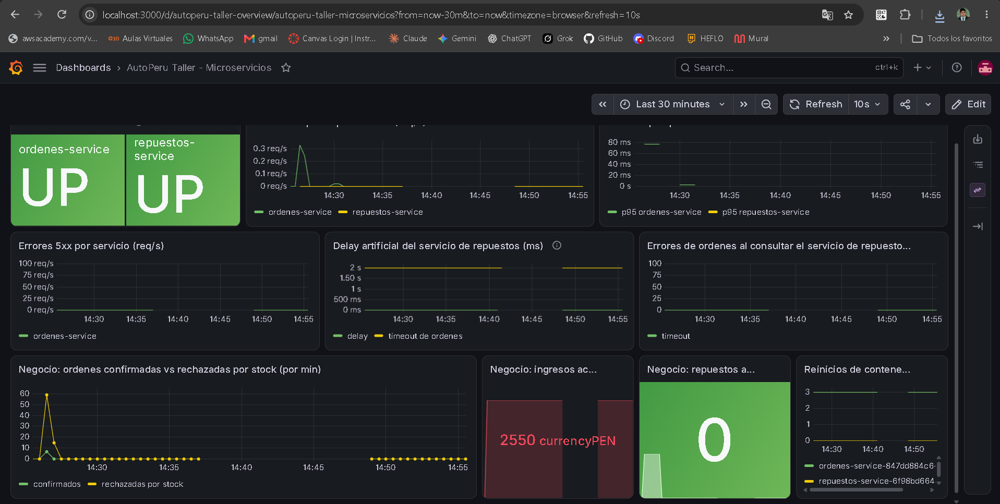

**Evidencia en Prometheus (durante la falla):** `RepuestosAgotados` y `OrdenesRechazadasPorFaltaDeRepuestos` en FIRING, mientras el grupo `autoperu-taller.disponibilidad` sigue en INACTIVE: la infraestructura esta sana y aun asi se pierden ventas.

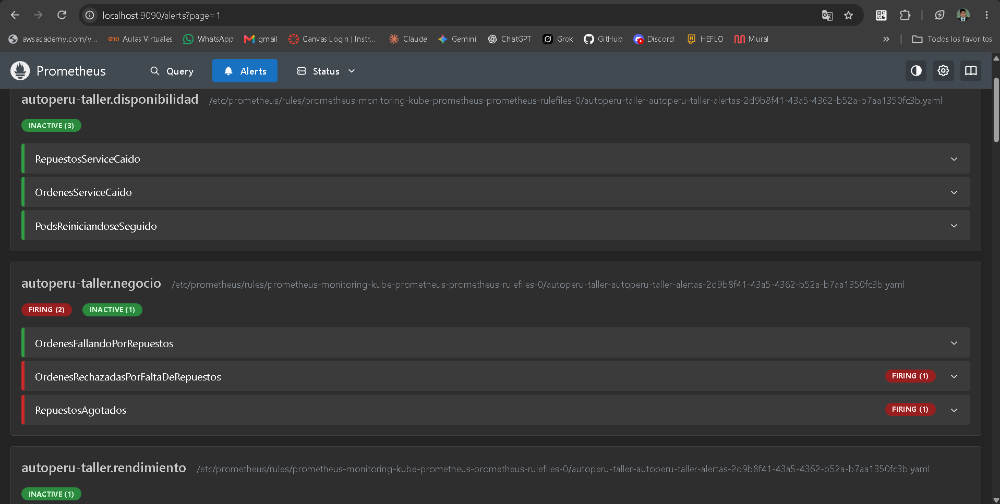

**Resolucion.**
```bash
./scripts/casuisticas/c3-resolver.sh     # PUT /api/repuestos/1/stock {"stock":30}
```

**Evidencia de la recuperacion.** Con el stock repuesto, las tres alertas de negocio vuelven a INACTIVE:

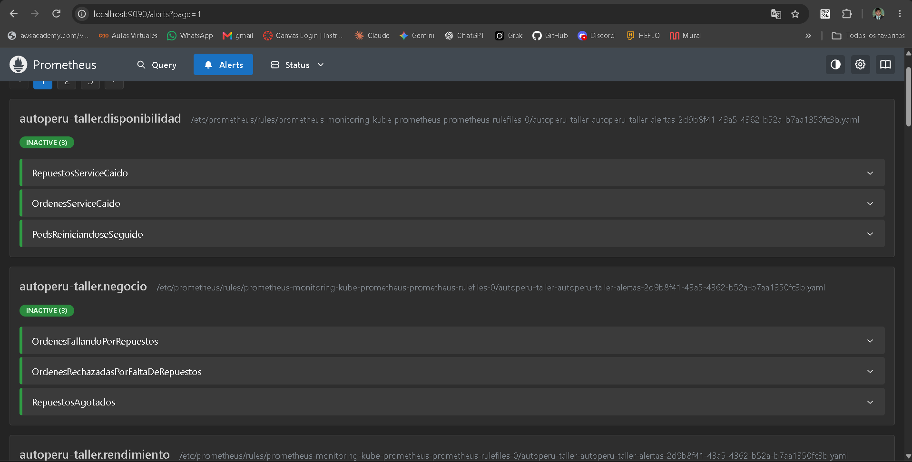

**Leccion tecnica.** Monitorear solo infraestructura (UP, CPU, latencia) no detecta perdidas de negocio. Las metricas propias de la aplicacion (Gauge de agotados, Counter de rechazos) convierten un problema silencioso en una alerta accionable.

---

## Parte D - Evidencias del sistema

1. `/targets` de Prometheus con `repuestos-service` y `ordenes-service` en **UP**:

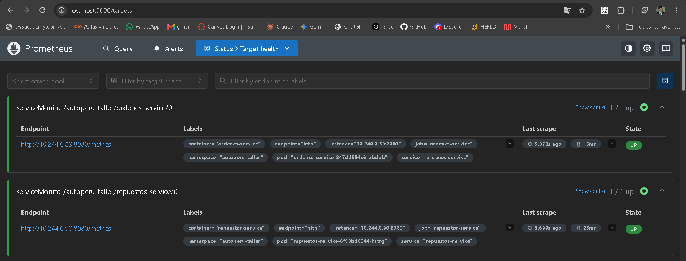
2. Dashboard de Grafana "AutoPeru Taller - Microservicios" con los paneles funcionando (`k8s/monitoring/dashboards/autoperu-taller-dashboard.json`):


3. `kubectl get pods -A` con todos los pods en **Running** (aqui, el namespace `autoperu-taller`):

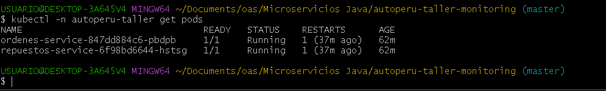
4. Al menos una alerta en **FIRING** (Prometheus `/alerts` o Alertmanager) durante una casuistica (casuistica 1, alerta `PodsReiniciandoseSeguido`; las de las casuisticas 2 y 3 estan en la Parte C):


---

## Observaciones del despliegue

1. **Reinicios al arrancar.** En el primer despliegue ambos pods reiniciaron 2 veces. Los eventos de Kubernetes mostraron `Liveness probe failed: connection refused`: el liveness empezaba a probar antes de que la JVM terminara de iniciar (el log marca `Started ... in 79 seconds`). Se corrigio agregando un `startupProbe`, y desde entonces el contador de reinicios no volvio a subir por esta causa.

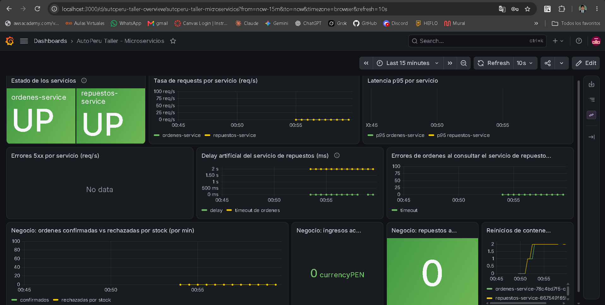

2. **Nodo `NotReady` en Minikube.** Minikube sobre Docker Desktop (Windows) dejo el nodo en `NotReady` durante una prueba. Los eventos mostraron `NodeNotReady` y `Liveness probe failed: context deadline exceeded`, lo que provoco un reinicio de `ordenes-service`. Fue una inestabilidad del entorno local, no de la aplicacion; el nodo se recupero y, tras apagar y encender el equipo, bastaron `minikube start` y `./scripts/port-forward.sh`.

3. **Estado en memoria.** Por requisito del trabajo todo vive en memoria, asi que cada redespliegue reinicia el stock a su valor inicial y los contadores de ordenes. Por eso, al resolver las casuisticas 1 y 2, el servicio de repuestos vuelve a tener su stock de partida.